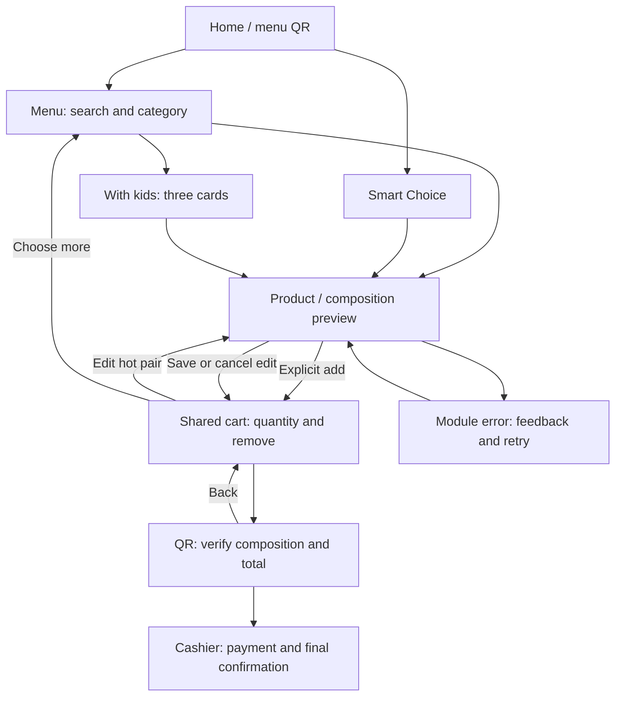

# Product review: menu control and family selections

The initial audit used `f72a4c00ce3578ebf383eb7d0469785c1240551d`.
It found two reproducible moderate defects: a mobile product photo covering
the title, and a rejected share-module import preventing subsequent retries.
The menu also lacked local editing of a hot drink/dessert pair and a visible
starting point for a guest ordering with a child.

## Result

- Mobile product grid rows now follow their content, preserving readable titles.
- Share loading recovers after a temporary failure, with localized feedback.
- An existing hot drink/dessert pair can be edited in the menu cart. Explicit
  Save replaces the original group atomically; Cancel preserves it. A stale
  editor cannot overwrite a newer quantity, flavor or removal from another tab.
- Three optional family cards use existing products and current catalog prices.
  Preview opens without adding anything. Unchecking components updates the total;
  explicit Add creates independently removable ordinary cart lines. A capacity
  error cannot leave a partially added recipe.

| Card | Existing products | Ordinary price |
| --- | --- | ---: |
| Milk and cookie | Milk 60 + cookie 100 | 160 TRY |
| Simit break | Milk 60 + simit 35 + cookie 100 | 195 TRY |
| Milk and cake roll | Milk 60 + cake roll 170 | 230 TRY |

The entry is next to the menu introduction and at `menu.html#menu-family`.
Copy and behavior support Turkish, English and Russian. These are suggestions
from the ordinary menu, without invented discounts, child portions or dietary
guarantees. Water and juice are absent from the digital catalog; their actual
availability, prices and volumes need confirmation from the café.

## Journey map



Canceling a new preview returns to its originating card without changing the
order. Maps, Instagram and menu sharing are separate actions, not order submission.
Ready-offer SKUs remain whole products; the new composition editor is limited
to a two-component hot drink/dessert pair, not every possible group.

## Remaining product questions

| Priority | Observation | Next check |
| --- | --- | --- |
| P3 | The menu introduction keeps the first price below the initial viewport at 390×844 and 1440×1000 | Compare a compact introduction and time to first correct addition |
| P3 | Product names/prices are outside the photo button; a name tap does not open the item | Observe new guests; consider an explicit Select action |
| P3 | Cold drink/dessert combinations have different controls in menu and Smart Choice | Check demand for matching optional dessert selection |
| P3 | Water, juice, volumes and small portions are not established in catalog data | Confirm actual café products and descriptions before extending recipes |

The approved logo remains recognizable. Its large repeated placement is a
hierarchy question; aesthetic preference alone does not establish a defect.
No measured revenue effect or full accessibility conformance is claimed.

## Reproducible validation

```sh
npm run check
npm run verify:security
node scripts/premium-feedback-regression.mjs
node scripts/test-menu-cart-edit-browser.mjs
node scripts/test-menu-family-browser.mjs
node scripts/test-menu-share-loader-browser.mjs
```

Focused browser regressions run in the existing Premium feedback workflow.
The checks cover explicit commit/cancel, latest shared state, independent removal,
quantity limits, reduced motion, fallback dialogs, focus, loading failures and
retries. Security checks also execute the actual worker against old cached family
assets and negative controls with its exact-query rule removed.

Local product scenarios passed in Playwright Chromium, Firefox and WebKit on
Linux. These are engine and viewport tests, not physical Xiaomi, Huawei, OPPO,
vivo, shipping Safari or actual native sharing/cashier/payment tests. The audit
inventory has 22 journey families; it does not exhaust all product combinations.
