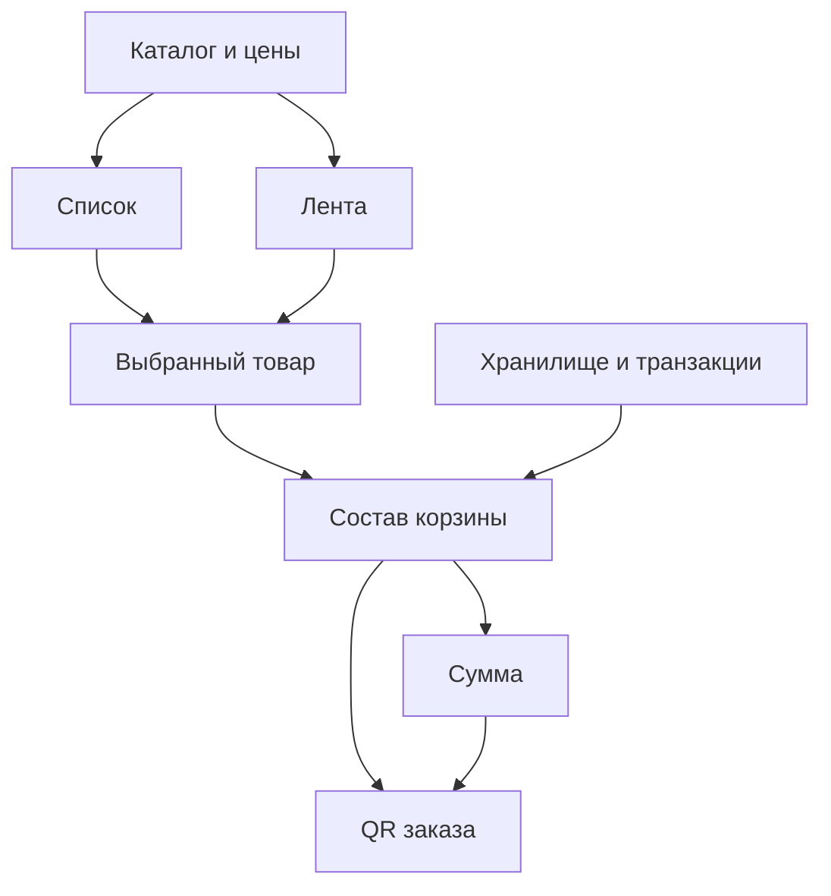

# Регресс функций и времени отклика Robys

Пайплайн связывает пользовательское действие, зависимость, наблюдаемый результат,
измерение и исполняемую проверку. Его цель — находить задержки и нарушения состояния
за пределами переключения списка и ленты и показывать, какую цепочку исследовать.
Он не объявляет причиной ошибки ближайший изменённый файл или соседний узел графа.

## Что входит в первую версию

`qa/regression-pipeline.json` содержит 13 областей, 22 существующих набора проверок,
31 узел зависимостей и 33 направленных связи с описанием механизма и ссылкой на код.
Граф не заменяет исторический граф из `qa/manual-regression/causal-graph.json`:
ручные 135 кейсов сохраняют свои варианты, даты и границы подтверждения.

| Область | Автоматическая проверка | Измеряемые действия |
| --- | --- | --- |
| Вход и навигация | Главная, клавиатура, адаптивные размеры | Главная → меню |
| Каталог и язык | Поиск, категории, TR/EN/RU и сохранение состояния | Поиск, очистка, категория, язык списка и ленты |
| Представление меню | Лента, история и общая корзина | Список → лента, лента → список |
| Карточки и предложения | Варианты, отмена, комбо, семейные наборы | Открыть товар, добавить, открыть комбо и семейные варианты |
| Фото и взаимодействия | Загрузка, fallback, лайки, передача позиции, просмотрщик, звук | Лайк, поделиться, Reels, Stories, включить звук |
| Подбор и Discover | Рекомендации, бюджет, конструктор и точный состав пары | Начать подбор, ответить, продолжить |
| Корзина и оформление | Состав, сумма, конкурентные изменения, устаревший черновик, QR | Открыть корзину, изменить количество, оформить, удалить |
| Касса и восстановление | Изолированные HTTP/модельные тесты ролей, статусов, повторов и offline | Время серверных операций пока не измеряется |

Поддержка движков объявлена у каждого набора отдельно. Основные браузерные наборы
запускаются в Chromium, Firefox и WebKit. Некоторые существующие проверки Discover,
загрузчика передачи позиции, редактирования, отклика и настоящего service worker
поддерживают только Chromium. Node-проверки кассы не считаются браузерной проверкой.
Граница каждого набора записана в поле `boundary`.

Пример связей общего каталога с разными пользовательскими результатами:



Полный машиночитаемый граф хранится в реестре. Связи описывают зависимости;
конкретную причину регресса устанавливает отдельный эксперимент.

## Как устроено измерение

`qa/regression-journeys.json` задаёт 25 действий, ширины 390 и 1280 пикселей и три
цикла на каждую ширину. Получаются 150 наблюдений на одну версию и профиль.

Начало измерения — первый захваченный пользовательский ввод до обработчика
приложения. Конец — правильное ожидаемое состояние DOM и два кадра анимации.
Проверяются результат и сохранение состояния; быстро показанный неверный товар,
сумма или язык не считаются успешным действием. Ошибки приложения, пропущенные
действия и незавершённые зависимости делают доказательство неполным.

Профили CI:

- Chromium: CPU ×4, задержка сети 150 мс, загрузка 1,6 Мбит/с.
- Firefox и WebKit: обычный CPU и сеть без искусственного замедления.
- Service worker в измерениях заблокирован; offline проверяется отдельным набором.
- Анимация включена. Окружение, версия браузера, кеш, ширины и протокол записаны в отчёте.

В каждом действии сохраняются наблюдавшиеся запросы ресурсов, их размеры и время,
доступные long tasks и интервалы кадров. Это диагностические признаки для графа.
При переходе на другой документ кадры и long tasks исходного документа не
переносятся; эти поля не доказывают отсутствие задержек во всей навигации.
Плавность прокрутки продолжает проверяться отдельным существующим gate.

Первая версия бюджета требует максимум 999 мс для каждого зарегистрированного
действия. Дополнительно сравниваются медиана и p95 с базовой версией: текущий предел
равен базовому значению ×1,15 +33,4 мс. Все циклы, идентификаторы и окружения обязаны
совпасть. При трёх циклах p95 фактически является максимумом выборки; это сигнал
локальной лаборатории, а не оценка распределения на устройствах посетителей.

Интервалы кадров и long tasks записываются для расследования. Они не заменяют
самостоятельный gate прокрутки, геометрии и плавности в
`scripts/compare-menu-responsiveness.mjs`. Существующие Lighthouse, visual,
security, integrity и post-deploy проверки остаются отдельными требованиями.

## Запуск CI и привязка к версии

`.github/workflows/causal-regression.yml` запускается на PR в `main`, push в `main`
и вручную. Независимые группы функций не останавливаются после ошибки соседней.
Каждый набор имеет timeout и отдельные stdout/stderr; артефакты сохраняются также
при ошибке, включая скрытую директорию `.artifacts`.

PR измеряет точные `pull_request.base.sha` и `pull_request.head.sha`, а не текущую
версию изменяемой ветки `main` и не синтетический merge-коммит. Push использует
точный предыдущий SHA события; при отсутствии пригодного значения, в том числе при
ручном запуске, берётся зафиксированный родитель проверяемого коммита. Если такой
базы нет, сравнительная проверка остаётся незавершённой.

Обе версии обслуживают собственные исходные runtime-файлы, но измеряются одним
и тем же harness и конфигурацией из кандидата. Проверяются SHA, дерево и состояние
рабочей копии до и после выполнения; отчёты с другой версией, изменёнными логами,
неполной матрицей или несовпадающим протоколом не могут дать общий PASS.

Медленная, но полностью и корректно измеренная база может превышать новый бюджет:
это не запрещает кандидату исправить задержку. Ошибочный или отсутствующий в базе
сценарий не подменяется успешным измерением и оставляет сравнение в HOLD.

В итоговом job отчёты загружаются только из этого запуска. Агрегатор требует все
объявленные пары «набор × поддерживаемый движок», все наблюдения трёх профилей и
их сравнения. Отчёт неполного запуска не становится зелёным по числу существующих
файлов или историческому `status: gated`.

## Локальное воспроизведение

Из корня репозитория после `npm ci` и установки нужного Playwright-браузера:

```bash
node scripts/run-regression-pipeline.mjs --group=feed --browser=chromium --output=.artifacts/causal-regression/functional/feed-chromium
node scripts/run-regression-pipeline.mjs --group=counter --browser=node --output=.artifacts/causal-regression/functional/counter-node
ROBYS_REGRESSION_BROWSER=chromium ROBYS_REGRESSION_PROFILE=native ROBYS_REGRESSION_LABEL=candidate ROBYS_REGRESSION_OUTPUT=.artifacts/causal-regression/metrics/chromium-native/candidate node scripts/measure-regression-journeys.mjs
```

Для сравнения сначала измерьте другой точный коммит той же командой из кандидата,
указав `ROBYS_REGRESSION_ROOT`, `ROBYS_SOURCE_REVISION`, метку `baseline` и отдельную
выходную папку. Кандидат измеряется с меткой `candidate` и своим точным SHA.

```bash
node scripts/compare-regression-journeys.mjs baseline/report.json candidate/report.json comparison/report.json
node scripts/aggregate-regression-pipeline.mjs .artifacts/causal-regression --output=.artifacts/causal-regression/summary
```

Один локальный набор закономерно оставляет остальные функции в NOT_RUN.
Измерение только Chromium/native полезно для локального исследования и не закрывает
объявленную матрицу CI. Изменённая рабочая копия сохраняет собственный digest и не
является доказательством проверки опубликованного чистого коммита.

## Чтение графа и расширение покрытия

Для неуспешного сценария отчёт показывает затронутую функцию и доступные пути
зависимостей. Пример: каталог → runtime меню → выбор товара → изменение корзины →
сумма → QR. Это список проверяемых гипотез. Причину подтверждает воспроизводимый
механизм и различающий эксперимент: например, намеренная ошибка импорта с успешным
контрольным прогоном или исправление конкретного пересчёта при сохранённых входных
данных. Само достижение узла по ребру причины не доказывает.

Добавляя функцию, внесите её наблюдаемый инвариант, узлы, механизм связи и
исполняемые проверки в реестр. Если для неё нужен показатель отклика, добавьте
действие и корректный критерий завершения в измеритель и бюджет. Общий валидатор
должен отклонять пропуски и дубликаты; добавляйте отрицательную проверку нарушения
результата или бюджета, а не тест наличия строки в workflow.

Все 25 действий не означают «весь продукт проверен». Реальный телефон, качество
звука на устройстве, системная передача ссылки адресату, физическая камера,
настоящая оплата, внешние сервисы и все неописанные варианты остаются явными
пробелами в `gaps`. Нативный share в браузерных fixture проверяет обработку исходов,
а не фактическую доставку получателю. Автоматический регресс не подменяет эти проверки.
