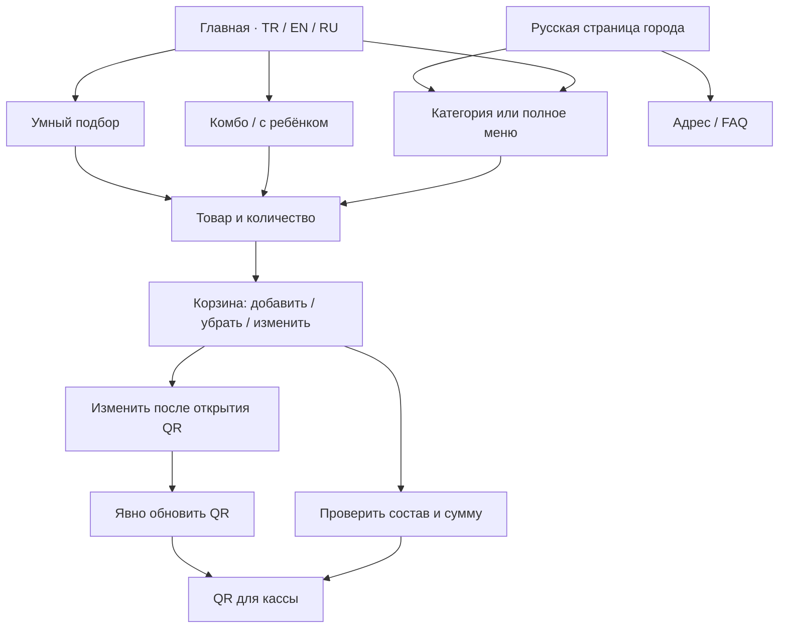

# Homepage menu regression — 19 October 2026

User report: Russian menu text escapes its layout on the desktop homepage.
Initial revision: `f9e23daf1dc5fac69e093a4ed33eaab03b9ada8c`.
Local captures used working trees based on the revision recorded in each packet
and include emitted/source hashes. Initial captures were based on the revision
above; the enlarged-text follow-up was based on `b0efc5b3`. A local packet’s HEAD
field is not a claim that its dirty working tree was already committed. Current-
head CI binds the committed release candidate.

## Integration with concurrent main changes

During validation, PR #445 advanced `main` to
`585135e07d08bb2680d4893b5bfc5ee89ca286f6`. The candidate integrates that revision:
the counter workflow, two ready kids sets, three editable family ideas, localized
menu skip link, new photos, counter cache bypass and current catalog/build logic
are retained. The upstream skip-link variant adds a one-pixel offscreen clearance
while preserving the same focus behavior. Its document-region screenshot capture
also fixes the two locator-crop artifacts observed against the old baseline.

The integrated manifest has 457 public files. Old-baseline evidence below remains
historical; H4 received no CI execution while the PR was conflicted. All release
conclusions require fresh CI and screenshots against the new main revision.

## Confirmed findings and fixes

1. At 1121 CSS pixels, the homepage category preview switches to two columns.
   Its 78px icons, 22px gap and padding leave too little room for Russian copy.
   Native text Range measurements found six title/description lines entering the
   arrow gutter by 3–17px. The 981px countercondition and desktop header passed.
   The repair keeps two columns, uses 54px icons and a 12px gap, and gives copy
   a shrinkable grid track and safe wrapping. Font sizes and all six links remain.
   Mobile titles can use the lines they need instead of being cut at two lines.
2. Closed mobile navigation accepted Tab focus on invisible links. Escape did
   not close the open navigation. Closed links are now hidden from keyboard
   navigation; opening focuses the first link, Tab stays within the open menu
   and its controls, and Escape closes it and restores the menu button's focus.
   The button's accessible open/close name uses the selected language.
3. JavaScript used an 860px mobile breakpoint while CSS used 980px. An open
   mobile menu now survives changes within that layout and closes at 981px.
4. Returning visitors need the repaired bytes. The build now revisions the home
   preview/mobile CSS and app together, binds them to the service-worker cache
   namespace and precaches each exact URL. Old queries cannot satisfy new ones.
5. Review caught focus remaining in hidden navigation after native section links.
   Those links close with focus recovery and their section destinations are
   focusable with `tabindex="-1"`, so native fragment navigation can focus the
   section without adding it to the normal Tab sequence. The test rejects focus
   on hidden links or BODY/HTML while requiring the correct native scroll.
   The existing choice-help suppression test now follows the intentional first
   navigation link focus rather than expecting focus to stay on the toggle.
6. The first CI build exceeded the unchanged 5% JavaScript transfer-growth limit
   by about 18 bytes. Emitting translations as UTF-8 instead of ASCII escapes
   reduces `app.js` from 35,595 to 24,767 bytes with every translation retained.
   Both fresh Lighthouse profiles at `b0efc5b3` passed: 22,703 bytes total JS versus
   22,139 baseline (+2.548%, unchanged 5% limit). The following accessibility
   repair changes CSS/cache bytes and must receive fresh current-head checks.

7. An additional narrow-screen check found Russian “Контакты” reaching
   x392.3125 at a 320px viewport with 200% root-font text. The open menu now
   limits each anchor to its available width, wraps oversized words, and permits
   vertical scrolling with safe alignment when enlarged content exceeds height.
   At the same text size the unfocused skip link was 122.375px tall but hidden
   with a fixed -100px offset, leaving a 22.375px white strip. A height-relative
   transform now hides it completely and restores it on keyboard focus.
   Before opening the menu, the same text-size check also measured overflowing
   hero/About/Visit headings and a feature paragraph: RU document width was
   572px at a 320px viewport. Headings and those two text containers now permit
   long-word wrapping; the mobile grid tracks can shrink below intrinsic text
   width. The regression checks document and NativeRange bounds before opening
   the overlay, separately from the overlay’s own width and scrolling.
   A follow-up isolated the remaining 5px document overflow to the dynamically
   added “Познакомиться со вкусом дня” link. Its flex box now fits the menu intro
   and its label can shrink and wrap while retaining the arrow and destination.

8. The shared hidden-navigation CSS also exposed missing focus recovery in the
   standalone Russian landing page. Its own handler now focuses the first open
   link, cycles Tab, restores the toggle on Escape, and leaves native Location/
   FAQ navigation focused on the visible section. Six standalone cases passed
   across three engines at 390/900px; pre-fix BODY/hidden-link counterexamples and
   post-fix SECTION focus are retained in `ru-standalone-focus.json`.
9. The iPhone-profile WebKit route harness started its five-second popup timer
   before a real click spent 4.807 seconds waiting for actionability. The failed
   trace left only 128ms after click completion; an unchanged-head repeat passed.
   This identifies an inadequate observation window without proving the sole
   cause of that failed handoff. The harness now arms its observer before the
   separately bounded click and retains the same 5000ms window after the click.
   Actual-helper controls accepted a 5.1s action followed by a 0.2s popup and
   rejected absent/late popups, with listener cleanup; all five controls passed.
   The corrected harness then passed all five actual route links in local HTTPS
   WebKit with unchanged file hashes. Google Maps responses were controlled: this
   verifies native popup URLs and the site’s source-page preservation, not the
   external service or a physical iPhone app handoff; see `ios-route-followup.json`.

## Reproducible checks

`scripts/test-home-menu-responsive-browser.mjs` serves actual emitted files over
local HTTPS with the original CSP. Its default matrix is 180 cases: Chromium,
Firefox and WebKit; TR/EN/RU; 15 widths from 320 to 1920px; plus five widths with
200% root-font text enlargement. It checks real text rectangles, clipping,
icon/arrow spacing, header intersections and native category destinations.
Failures and representative Russian successes have screenshots and JSON geometry.

`scripts/test-home-navigation-browser.mjs` checks 18 keyboard and native-link
standard journeys across three engines, three languages and 390/900px initial widths,
(42 total cases with enlargement and standalone-RU checks), including 900→901→980→981px transitions and persisted language in the catalog.
Additional cases exercise 200% root-font text at 320×568 and 568×320, checking
real glyph bounds and access to every navigation link. Six further cases cover
the standalone Russian landing page, including Escape and native fragment focus.
`scripts/test-home-navigation-cache.mjs` checks actual emitted URL/cache identity
and exercises the shipped worker against stale cached responses and fault injection.

The separate Home menu and keyboard CI matrix runs these checks for every engine
and uploads `home-navigation-<engine>-<head>` artifacts. The existing Order
reliability matrix covers category/order entry, editable combos and family sets,
add/remove/quantity, concurrent storage, immutable QR and explicit refresh,
cashier decoding, photograph recovery and enlarged pairing prices.

## Evidence and limits

| RU homepage at 1121px | Screenshot |
| --- | --- |
| Before the card repair | [Before](../../qa/evidence/home-menu-20261019/before-ru-1121.png) |
| After the card repair | [After](../../qa/evidence/home-menu-20261019/after-ru-1121.png) |

The completed focused local matrix passed 36/36 cases: all three engines and
languages at 320/1121/1440px, plus 981px with 200% root-font text. Source hashes
were unchanged during that run; the compact result packet is
`qa/evidence/home-menu-20261019/responsive-results.json`. The cache suite passed
5/5, including stale-cache fault controls.
The completed native navigation run passed 18/18 journeys with unchanged emitted
home assets across Chromium 140.0.7339.186, Firefox 141.0 and WebKit 26.0. Its
compact packet is `qa/evidence/home-menu-20261019/navigation-results.json`.
The review follow-up passed six helper-suppression cases and three native-focus
cases across the same engines; About/Visit received visible, onscreen SECTION
focus. The preceding BODY-focus failures are preserved as counterexamples in
`focus-followup-results.json`. `utf8-runtime-parity.json` confirms the actual
emitted UTF-8 app matches a fresh production build and shares all 3515 decoded
AST nodes with an isolated ASCII build of the same source.
The byte-parity verifier uses the same UTF-8 compiler option and strict
`Buffer.equals` with a bounded failure message. Independent in-memory controls
accepted the actual app and rejected both a one-byte change and a stale ASCII
compiler; see `static-parity-controls.json`.

The local baseline recording is `home-menu-baseline-fast`: RU981 PASS and RU1121
FAIL with six measured overlaps. `home-menu-critical` repeats RU1121 after the
repair and RU981 with 200% text: both PASS. The first keyboard attempt exposed a
visibility-transition focus issue; changing the transition to opacity/transform
only corrected it. Its clean Russian smoke then passed. Earlier interrupted or
timed-out harness runs are retained as incomplete runs, not counted as passes.

The final enlarged-text follow-up passed all 36 navigation cases (18 standard
plus 18 enlarged) across all three engines/languages with unchanged input hashes;
see `enlarged-navigation-results.json`. The final card follow-up passed 6/6:
RU1121 and RU981 with 200% root-font text in all three engines; see
`responsive-stable-followup.json`.

Historical H2 CI evidence is retained in `h2-journey-ci.json`: all six Home/Order
jobs and both Lighthouse profiles passed at `b0efc5b3`. That packet explicitly
excludes the subsequently discovered narrow/enlarged navigation and page-text
states. Its gap label “skip-link contrast” is a metadata wording error: the
observed issue was an unfocused skip-link strip remaining onscreen, and no
color-contrast measurement was performed. `text200-before.json` and
`skip-link-before-fix.json` preserve the pre-fix measured geometry.

Historical H3 CI is retained in `h3-journey-ci.json`: 180 responsive and 36
navigation cases passed, as did all six Home/Order jobs, both Lighthouse profiles
and native security. Both route attempts are preserved. This predates the
standalone-RU fix and the route-harness correction.

Final release evidence must be read from the current-head CI artifacts and native
checks. Engine tests and viewport/text emulation do not establish physical iOS,
Safari, Xiaomi, Huawei, OPPO, vivo or their built-in-browser compatibility. No
real order/payment was submitted. This is representative regression coverage,
not proof that every possible device and product state is defect-free.

## Integrated local checks after main sync

The resolved integration commit is `4bed909a7860a00654085f4bf7c345b864b1b80b` (tree
`f4dda9f1e1916de72cfd03dfa228086e3410c5a1`), combining PR head
`58e4cd77139ca4ba1a8f9c17fdb913ef14c19a72` with main
`585135e07d08bb2680d4893b5bfc5ee89ca286f6`. Local tests began before that merge
commit existed, so their original HEAD markers identify the older checkout.
`integration-source-equivalence.json` independently compares every captured
SHA-256 with actual committed H5 bytes and the working tree: 62 unique files
(10 navigation, 17 kids-source, 4 emitted kids-runtime and
33 counter/config bindings; groups overlap). This is byte equivalence, not
a claim that these local runs were committed-head CI.

| Local suite | Observed result | Preserved limitation |
| --- | --- | --- |
| Native home / enlarged / RU standalone navigation | 42 unique cases have successful executions in Chromium 140.0.7339.186, Firefox 141.0 and WebKit 26.0 | The full command was 41/42, exit 1: the last WebKit RU standalone 900px case timed out only on its final catalog screenshot at 15 seconds, after all behavioral assertions. Its exact unchanged-case retry passed 1/1. This is not one clean 42-case command. |
| Two ready-made kids sets × TR/EN/RU × three engines | 18 unique cases have observed passes; initially 17/18, then the single-case retry passed | WebKit big/RU initially exceeded the unchanged 7000ms page-load timeout before scenario assertions. Earlier incorrect group-identity test-oracle failures are retained separately. |
| Counter service Node suite | 74/74 tests, exit 0 | This count includes nested Node subtests, not browser journeys or a production counter transaction. |

Navigation checks used emitted documents over local HTTPS without replacing the
production handlers or bypassing CSP. They cover native fragment focus/scroll,
Escape and natural Tab, localized labels, 900→901→980→981 transitions, catalog
language persistence, and 200% root-font text at 320×568 and 568×320. The measured
10-file navigation envelope stayed equal across both runs; emitted `app.js`
explicitly retained SHA-256
`696430fd392491371367f0d45082f88f6cc7b145d8dc20f9f30bf937459b35e9`
and matches H5. The upstream height-relative skip-link variant was retained and
passed the enlarged geometry/focus assertions. Screenshot-timeout cause remains
unconfirmed; no timeout was increased to obtain the retry pass.

The kids checks exercised both existing native cards through the ordinary add
flow: visible busy state, one add despite a second pending activation, canonical
items/prices, quantity changes, component replacement, removal, unrelated order
preservation and restored focus. Their four source-fixture modules were
independently byte-equal to emitted `menu-app.js`, `menu-family-ui.js`,
`menu-order-ui.js` and `order-storage.js`; the captured runtime hashes match H5.
The counter suite kept all 33 guarded files unchanged before/after its run and
those hashes also match H5.

Compact packets retain useful facts, original report hashes, source identity,
failures and retries without screenshot bulk:

- `qa/evidence/home-menu-20261019/integration-navigation-results.json`
- `qa/evidence/home-menu-20261019/integration-kids-results.json`
- `qa/evidence/home-menu-20261019/integration-counter-results.json`
- `qa/evidence/home-menu-20261019/integration-source-equivalence.json`

These are bounded local integration checks. Current-head CI, security, visual,
integrity/performance checks and published-site verification still determine
release readiness. Physical Safari/iOS and Xiaomi/Huawei/OPPO/vivo browser gaps
remain; root-font enlargement is not native browser zoom.

## H5 CI and visual disposition

At `4bed909a7860a00654085f4bf7c345b864b1b80b`, all six Home/Order CI jobs
passed. Home covers 180 responsive and 42 navigation cases. Each Order engine
passed Family 31, combos 48, transactions 116, storage 25, checkout staleness 6,
built QR/cashier 23, lazy entry 10, pairing 6 and promo 9. Counter passed 74/74.
Both Lighthouse profiles, CodeQL, SAST, passive DAST, security foundation and the
five iOS-profile WebKit route links passed. The derived merge used by some jobs
has exactly the H5 source tree. `h5-journey-ci.json` preserves the actual jobs,
attempts, identities and limits; `h5-review-security.json` records fresh Codex
no-findings, the resolved RU thread, and unanswered Jules without inventing an
approval. H2/H3 Lighthouse wording is corrected in the H5 packet: summary values
are medians across six homepage/menu LHRs, not homepage-only measurements.

H5 Visual run `39247387929` failed six of 43 comparisons, identically in both
attempts and final. Its original failure remains evidence. Root inspected all
six pairs, including every region of both full landings; a second assistant
independently inspected both full pages. All six category labels, descriptions,
arrows and links remain; smaller icons and gaps give copy more room. The desktop
menu and full landing are exactly 53px shorter. Tablet height stays unchanged;
its changes are within category icon/text rows. The social and Visit pairs
retain their wording and controls with minor raster/alignment changes. No new
clipping, collision or lost content was observed in these pairs.

The supplemental `ru-home-menu-20261019.json` records assistant inspection,
not human approval. It binds all 457 public files and 338 additional tracked
source/build/counter/workflow inputs, and accepts only the six observed failure
rows with exact dimensions/pixel totals and no increased observed ratio. The
shipped verifier accepted the real summary. All 14 isolated controls passed,
including rejection of changed bytes, missing/extra/duplicate failures, duplicate
records, empty bindings, changed crop/dimensions and a one-pixel ratio excess;
repository input bytes remained unchanged. Thresholds and capture scenarios
were not changed. See `h5-visual-*` packets for provenance, summary, independent
observations and controls. The evidence-only successor must pass fresh CI;
the original H5 red visual job is not relabelled as a green run. Publication and
live UI/integrity verification are subsequent release steps.

## Resize round-trip review follow-up

H6 `b94c3317cfa66fbf26056847fd8ccc142a10d12b` passed all 32 observed workflow
runs, including the full Visual continuation. The fresh visual artifact retained
the six exact H5 failure metrics and byte-identical reviewed image pairs. This
did not prove every interaction was correct: fresh Codex review `4313821191`
found focus recovery missing when returning from desktop to the mobile layout.

Twelve actual H6 counterexamples reproduced this across Chromium, Firefox and
WebKit on both home and the standalone RU page. An open menu's first link kept
focus at 981px, then focus reset to BODY at 900px. With the toggle focused,
the reset already happened at 981px. The old test checked closure and visible
desktop links, then clicked the toggle on return; that click concealed the
lost-focus state. The new assertion inspects focus before another click.

The resize handler now moves focus to the always-visible brand link when an
open menu closes at desktop width and focus belonged to the disappearing menu,
toggle, or was already lost to BODY/HTML. It uses `preventScroll` and preserves
focus on unrelated language controls and ordinary desktop CTAs. The regression
adds both first-link and toggle round trips plus these negative controls to the
existing navigation cases. Historical H5/H6 packets remain labelled by their
actual revisions; they are not current-head proof for this follow-up.

The local follow-up completed 41/42 initially; its single Firefox 320×568 text200
case timed out on a read-only navigation measurement after earlier assertions.
An exact unchanged-case retry passed 1/1 with the same 15-second limit. All 24
existing standard/standalone journeys extended with the new resize assertions
passed on the first run, retaining 240 visible focus snapshots. The measured
10-file envelope and the complete 795-binding digest remained stable. See
`h7-resize-focus.json`; the initial failure and its screenshot hash are retained.

The local visual differential is explicitly INCOMPLETE: it captured 34 paired
images before the unchanged 30-second screenshot timeout, with 31 byte-identical
pairs and three differing capture states. It provides no 43-cell verdict or
source-equivalence claim. Those three differences are not accepted by the
supplemental record. Its original six-cell dimensions/ratios are unchanged;
only the seven changed focus-repair/source/cache input bindings were provisionally
updated, with historical H5/H6 attribution preserved. Fresh current-head CI must
produce all 43 comparisons and actual pairs must be inspected before merge.

`h7-local-validation.json` records a complete repeated `npm run check` with an
explicit exit marker and final 22/22 takeaway suite, security354/no-secrets, and
the shipped verifier accepting the historical six-cell map against the exact
new input bindings. A preceding partial check log was not counted as a full pass.
This input validation is not a new-candidate CI screenshot approval. The earlier
14 isolated verifier controls apply to the unchanged matcher/expected failure
policy; H7's actual CI and current image inspection remain the release gate.
