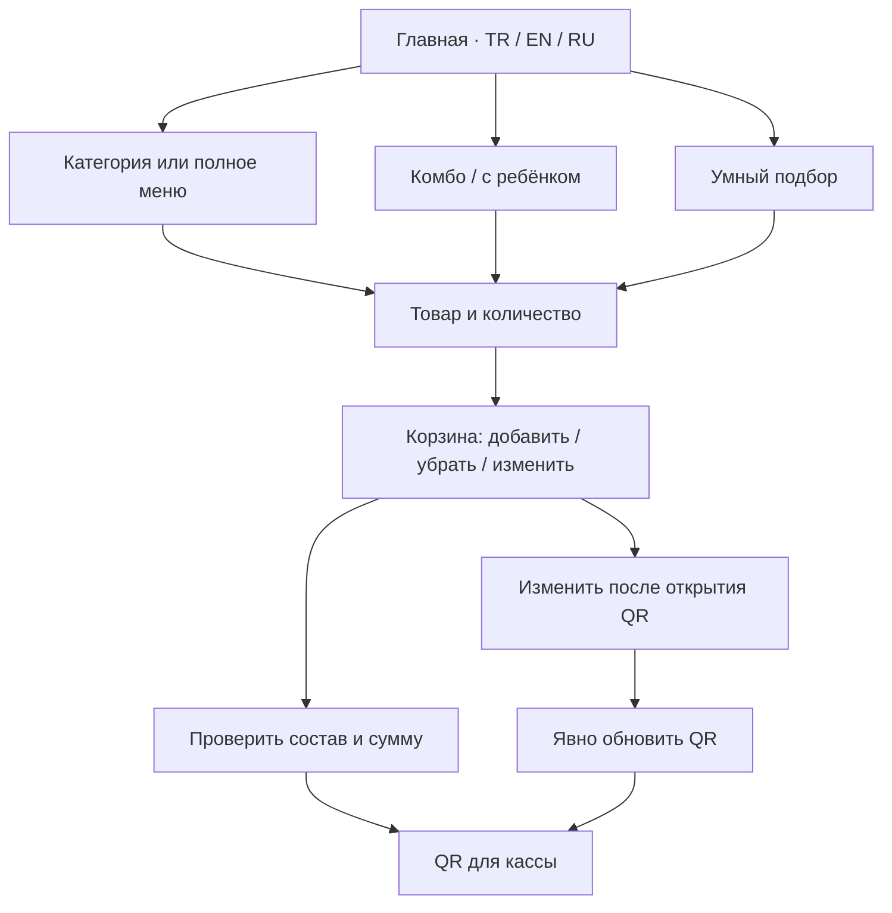

# Homepage menu regression — 19 October 2026

User report: Russian menu text escapes its layout on the desktop homepage.
Initial revision: `f9e23daf1dc5fac69e093a4ed33eaab03b9ada8c`.
Local post-fix captures used the working tree based on that revision and include
content hashes; current-head CI binds the committed release candidate.

## Confirmed findings and fixes

1. At 1121 CSS pixels, the homepage category preview switches to two columns.
   Its 78px icons, 22px gap and padding leave too little room for Russian copy.
   Native text Range measurements found six title/description lines entering the
   arrow gutter by 3–17px. The 981px countercondition and desktop header passed.
   The repair keeps two columns, uses 54px icons and a 12px gap, and gives copy
   a shrinkable grid track and safe wrapping. Font sizes and all six links remain.
   Mobile titles can use the lines they need instead of being cut at two lines.
2. Closed mobile navigation accepted Tab focus on invisible links. Escape did
   not close the open navigation. Closed links are now hidden from keyboard
   navigation; opening focuses the first link, Tab stays within the open menu
   and its controls, and Escape closes it and restores the menu button's focus.
   The button's accessible open/close name uses the selected language.
3. JavaScript used an 860px mobile breakpoint while CSS used 980px. An open
   mobile menu now survives changes within that layout and closes at 981px.
4. Returning visitors need the repaired bytes. The build now revisions the home
   preview/mobile CSS and app together, binds them to the service-worker cache
   namespace and precaches each exact URL. Old queries cannot satisfy new ones.

## Reproducible checks

`scripts/test-home-menu-responsive-browser.mjs` serves actual emitted files over
local HTTPS with the original CSP. Its default matrix is 180 cases: Chromium,
Firefox and WebKit; TR/EN/RU; 15 widths from 320 to 1920px; plus five widths with
200% root-font text enlargement. It checks real text rectangles, clipping,
icon/arrow spacing, header intersections and native category destinations.
Failures and representative Russian successes have screenshots and JSON geometry.

`scripts/test-home-navigation-browser.mjs` checks 18 keyboard and native-link
journeys across three engines, three languages and 390/900px initial widths,
including 900→901→980→981px transitions and persisted language in the catalog.
`scripts/test-home-navigation-cache.mjs` checks actual emitted URL/cache identity
and exercises the shipped worker against stale cached responses and fault injection.

The separate Home menu and keyboard CI matrix runs these checks for every engine
and uploads `home-navigation-<engine>-<head>` artifacts. The existing Order
reliability matrix covers category/order entry, editable combos and family sets,
add/remove/quantity, concurrent storage, immutable QR and explicit refresh,
cashier decoding, photograph recovery and enlarged pairing prices.

## Evidence and limits

| RU homepage at 1121px | Screenshot |
| --- | --- |
| Before the card repair | [Before](../../qa/evidence/home-menu-20261019/before-ru-1121.png) |
| After the card repair | [After](../../qa/evidence/home-menu-20261019/after-ru-1121.png) |

The completed focused local matrix passed 36/36 cases: all three engines and
languages at 320/1121/1440px, plus 981px with 200% root-font text. Source hashes
were unchanged during that run; the compact result packet is
`qa/evidence/home-menu-20261019/responsive-results.json`. The cache suite passed
5/5, including stale-cache fault controls.
The completed native navigation run passed 18/18 journeys with unchanged emitted
home assets across Chromium 140.0.7339.186, Firefox 141.0 and WebKit 26.0. Its
compact packet is `qa/evidence/home-menu-20261019/navigation-results.json`.

The local baseline recording is `home-menu-baseline-fast`: RU981 PASS and RU1121
FAIL with six measured overlaps. `home-menu-critical` repeats RU1121 after the
repair and RU981 with 200% text: both PASS. The first keyboard attempt exposed a
visibility-transition focus issue; changing the transition to opacity/transform
only corrected it. Its clean Russian smoke then passed. Earlier interrupted or
timed-out harness runs are retained as incomplete runs, not counted as passes.

Final release evidence must be read from the current-head CI artifacts and native
checks. Engine tests and viewport/text emulation do not establish physical iOS,
Safari, Xiaomi, Huawei, OPPO, vivo or their built-in-browser compatibility. No
real order/payment was submitted. This is representative regression coverage,
not proof that every possible device and product state is defect-free.
