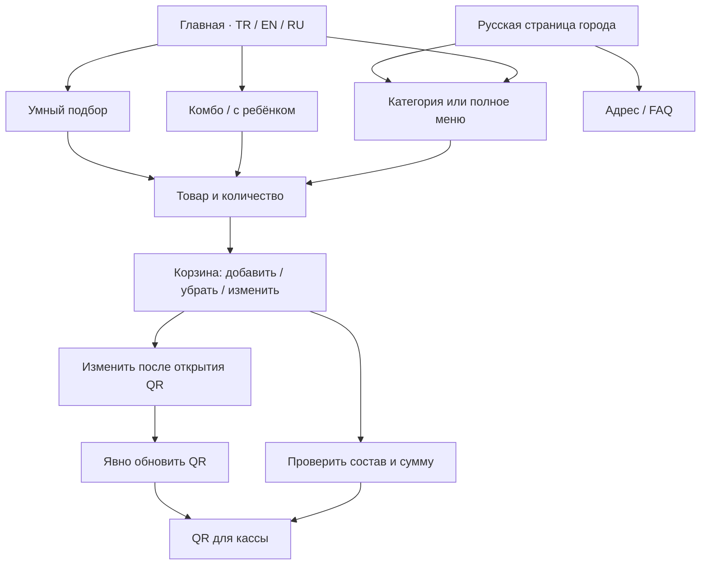

# Homepage menu regression — 19 October 2026

User report: Russian menu text escapes its layout on the desktop homepage.
Initial revision: `f9e23daf1dc5fac69e093a4ed33eaab03b9ada8c`.
Local captures used working trees based on the revision recorded in each packet
and include emitted/source hashes. Initial captures were based on the revision
above; the enlarged-text follow-up was based on `b0efc5b3`. A local packet’s HEAD
field is not a claim that its dirty working tree was already committed. Current-
head CI binds the committed release candidate.

## Confirmed findings and fixes

1. At 1121 CSS pixels, the homepage category preview switches to two columns.
   Its 78px icons, 22px gap and padding leave too little room for Russian copy.
   Native text Range measurements found six title/description lines entering the
   arrow gutter by 3–17px. The 981px countercondition and desktop header passed.
   The repair keeps two columns, uses 54px icons and a 12px gap, and gives copy
   a shrinkable grid track and safe wrapping. Font sizes and all six links remain.
   Mobile titles can use the lines they need instead of being cut at two lines.
2. Closed mobile navigation accepted Tab focus on invisible links. Escape did
   not close the open navigation. Closed links are now hidden from keyboard
   navigation; opening focuses the first link, Tab stays within the open menu
   and its controls, and Escape closes it and restores the menu button's focus.
   The button's accessible open/close name uses the selected language.
3. JavaScript used an 860px mobile breakpoint while CSS used 980px. An open
   mobile menu now survives changes within that layout and closes at 981px.
4. Returning visitors need the repaired bytes. The build now revisions the home
   preview/mobile CSS and app together, binds them to the service-worker cache
   namespace and precaches each exact URL. Old queries cannot satisfy new ones.
5. Review caught focus remaining in hidden navigation after native section links.
   Those links close with focus recovery and their section destinations are
   focusable with `tabindex="-1"`, so native fragment navigation can focus the
   section without adding it to the normal Tab sequence. The test rejects focus
   on hidden links or BODY/HTML while requiring the correct native scroll.
   The existing choice-help suppression test now follows the intentional first
   navigation link focus rather than expecting focus to stay on the toggle.
6. The first CI build exceeded the unchanged 5% JavaScript transfer-growth limit
   by about 18 bytes. Emitting translations as UTF-8 instead of ASCII escapes
   reduces `app.js` from 35,595 to 24,767 bytes with every translation retained.
   Both fresh Lighthouse profiles at `b0efc5b3` passed: 22,703 bytes total JS versus
   22,139 baseline (+2.548%, unchanged 5% limit). The following accessibility
   repair changes CSS/cache bytes and must receive fresh current-head checks.

7. An additional narrow-screen check found Russian “Контакты” reaching
   x392.3125 at a 320px viewport with 200% root-font text. The open menu now
   limits each anchor to its available width, wraps oversized words, and permits
   vertical scrolling with safe alignment when enlarged content exceeds height.
   At the same text size the unfocused skip link was 122.375px tall but hidden
   with a fixed -100px offset, leaving a 22.375px white strip. A height-relative
   transform now hides it completely and restores it on keyboard focus.
   Before opening the menu, the same text-size check also measured overflowing
   hero/About/Visit headings and a feature paragraph: RU document width was
   572px at a 320px viewport. Headings and those two text containers now permit
   long-word wrapping; the mobile grid tracks can shrink below intrinsic text
   width. The regression checks document and NativeRange bounds before opening
   the overlay, separately from the overlay’s own width and scrolling.
   A follow-up isolated the remaining 5px document overflow to the dynamically
   added “Познакомиться со вкусом дня” link. Its flex box now fits the menu intro
   and its label can shrink and wrap while retaining the arrow and destination.

8. The shared hidden-navigation CSS also exposed missing focus recovery in the
   standalone Russian landing page. Its own handler now focuses the first open
   link, cycles Tab, restores the toggle on Escape, and leaves native Location/
   FAQ navigation focused on the visible section. Six standalone cases passed
   across three engines at 390/900px; pre-fix BODY/hidden-link counterexamples and
   post-fix SECTION focus are retained in `ru-standalone-focus.json`.
9. The iPhone-profile WebKit route harness started its five-second popup timer
   before a real click spent 4.807 seconds waiting for actionability. The failed
   trace left only 128ms after click completion; an unchanged-head repeat passed.
   This identifies an inadequate observation window without proving the sole
   cause of that failed handoff. The harness now arms its observer before the
   separately bounded click and retains the same 5000ms window after the click.
   Actual-helper controls accepted a 5.1s action followed by a 0.2s popup and
   rejected absent/late popups, with listener cleanup; all five controls passed.
   The corrected harness then passed all five actual route links in local HTTPS
   WebKit with unchanged file hashes. Google Maps responses were controlled: this
   verifies native popup URLs and the site’s source-page preservation, not the
   external service or a physical iPhone app handoff; see `ios-route-followup.json`.

## Reproducible checks

`scripts/test-home-menu-responsive-browser.mjs` serves actual emitted files over
local HTTPS with the original CSP. Its default matrix is 180 cases: Chromium,
Firefox and WebKit; TR/EN/RU; 15 widths from 320 to 1920px; plus five widths with
200% root-font text enlargement. It checks real text rectangles, clipping,
icon/arrow spacing, header intersections and native category destinations.
Failures and representative Russian successes have screenshots and JSON geometry.

`scripts/test-home-navigation-browser.mjs` checks 18 keyboard and native-link
standard journeys across three engines, three languages and 390/900px initial widths,
(42 total cases with enlargement and standalone-RU checks), including 900→901→980→981px transitions and persisted language in the catalog.
Additional cases exercise 200% root-font text at 320×568 and 568×320, checking
real glyph bounds and access to every navigation link. Six further cases cover
the standalone Russian landing page, including Escape and native fragment focus.
`scripts/test-home-navigation-cache.mjs` checks actual emitted URL/cache identity
and exercises the shipped worker against stale cached responses and fault injection.

The separate Home menu and keyboard CI matrix runs these checks for every engine
and uploads `home-navigation-<engine>-<head>` artifacts. The existing Order
reliability matrix covers category/order entry, editable combos and family sets,
add/remove/quantity, concurrent storage, immutable QR and explicit refresh,
cashier decoding, photograph recovery and enlarged pairing prices.

## Evidence and limits

| RU homepage at 1121px | Screenshot |
| --- | --- |
| Before the card repair | [Before](../../qa/evidence/home-menu-20261019/before-ru-1121.png) |
| After the card repair | [After](../../qa/evidence/home-menu-20261019/after-ru-1121.png) |

The completed focused local matrix passed 36/36 cases: all three engines and
languages at 320/1121/1440px, plus 981px with 200% root-font text. Source hashes
were unchanged during that run; the compact result packet is
`qa/evidence/home-menu-20261019/responsive-results.json`. The cache suite passed
5/5, including stale-cache fault controls.
The completed native navigation run passed 18/18 journeys with unchanged emitted
home assets across Chromium 140.0.7339.186, Firefox 141.0 and WebKit 26.0. Its
compact packet is `qa/evidence/home-menu-20261019/navigation-results.json`.
The review follow-up passed six helper-suppression cases and three native-focus
cases across the same engines; About/Visit received visible, onscreen SECTION
focus. The preceding BODY-focus failures are preserved as counterexamples in
`focus-followup-results.json`. `utf8-runtime-parity.json` confirms the actual
emitted UTF-8 app matches a fresh production build and shares all 3515 decoded
AST nodes with an isolated ASCII build of the same source.
The byte-parity verifier uses the same UTF-8 compiler option and strict
`Buffer.equals` with a bounded failure message. Independent in-memory controls
accepted the actual app and rejected both a one-byte change and a stale ASCII
compiler; see `static-parity-controls.json`.

The local baseline recording is `home-menu-baseline-fast`: RU981 PASS and RU1121
FAIL with six measured overlaps. `home-menu-critical` repeats RU1121 after the
repair and RU981 with 200% text: both PASS. The first keyboard attempt exposed a
visibility-transition focus issue; changing the transition to opacity/transform
only corrected it. Its clean Russian smoke then passed. Earlier interrupted or
timed-out harness runs are retained as incomplete runs, not counted as passes.

The final enlarged-text follow-up passed all 36 navigation cases (18 standard
plus 18 enlarged) across all three engines/languages with unchanged input hashes;
see `enlarged-navigation-results.json`. The final card follow-up passed 6/6:
RU1121 and RU981 with 200% root-font text in all three engines; see
`responsive-stable-followup.json`.

Historical H2 CI evidence is retained in `h2-journey-ci.json`: all six Home/Order
jobs and both Lighthouse profiles passed at `b0efc5b3`. That packet explicitly
excludes the subsequently discovered narrow/enlarged navigation and page-text
states. Its gap label “skip-link contrast” is a metadata wording error: the
observed issue was an unfocused skip-link strip remaining onscreen, and no
color-contrast measurement was performed. `text200-before.json` and
`skip-link-before-fix.json` preserve the pre-fix measured geometry.

Historical H3 CI is retained in `h3-journey-ci.json`: 180 responsive and 36
navigation cases passed, as did all six Home/Order jobs, both Lighthouse profiles
and native security. Both route attempts are preserved. This predates the
standalone-RU fix and the route-harness correction.

Final release evidence must be read from the current-head CI artifacts and native
checks. Engine tests and viewport/text emulation do not establish physical iOS,
Safari, Xiaomi, Huawei, OPPO, vivo or their built-in-browser compatibility. No
real order/payment was submitted. This is representative regression coverage,
not proof that every possible device and product state is defect-free.
