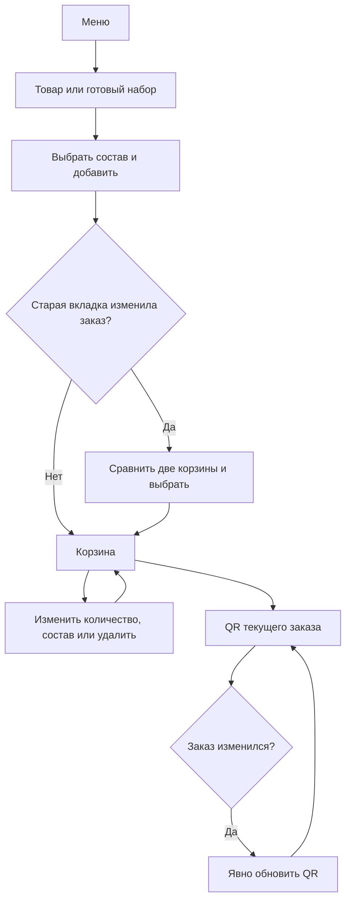

# Product audit follow-up — 18 October 2026

Audit base: `810f5e660b18d0179abcce8857733fb56d89375c`. Integrated main: `28a394998674a02afc720fd8c082e35320b02b90` (family photography and Kids Box concept).

The audit found a shared-order race, late navigation intents and several mobile selection obstacles. This change keeps one shared order across the menu and Smart Choice, makes family choices easier to find, and gives the customer explicit control over components and QR refresh.

| Finding | Acceptance behavior |
| --- | --- |
| RACE-01 | Concurrent additions, edits, quantities, variants and recommendations apply to the latest canonical order in one transaction. Both tabs converge; failed persistence does not report a successful addition. |
| RACE-02 | A delayed family/product/cart import cannot reveal, scroll or focus an older intent after a new choice or dismissal. |
| MENU-01 | The two verified ordinary-price promotional pairs expose their actual components. Removing or replacing the dessert preserves the drink and recalculates the current catalog total. |
| MENU-02 | A nonempty mobile order remains reachable while scrolling. The control clears content and safe areas and hides during search and dialogs. |
| MENU-03 | Smart Choice has a visible direct link to the full menu on mobile in TR/EN/RU; language and order survive both directions. |
| UI-01 | The Russian return label reads «На главную» and fits narrow screens. |
| PO-01 | A localized family shortcut on the home page opens the existing three editable recipes. |
| PO-02 | The menu introduction uses a compact approved wordmark. Each family card has one complete photograph and a localized heart ribbon. |
| PO-03 | A changed order produces a warning beside the immutable old QR. Only an explicit refresh creates the latest QR; an empty or unreadable order cannot silently replace it. |
| PERF-01 | The first menu photograph retains eager, high-priority loading. Other catalog photographs start within 150 px of the viewport and load on approach; unsupported or denied observers retain native loading. Redrawing the menu clears old observations. |
| PERF-02 | One content-revisioned stylesheet preserves all nine original CSS inputs byte for byte and in their original cascade order. The closed product dialog retains its branded image source with lazy loading. |
| A11Y-01 | Promotional prices stay inside their cards when text is enlarged to 200%, including WebKit. Their intrinsic width can grow without shrinking the type or clipping the currency. |

## Family content

The recipes remain ordinary catalog products, without a discount or new sale SKU: milk + cookie (160 ₺), milk + sesame simit + cookie (195 ₺), milk + cake roll (230 ₺). Each selected component is independently removable after adding. The three family photographs use the previously generated set images, encoded as the local 900×900 WebP assets from the integrated main branch. They are lazy loaded and available in the versioned offline cache; missing images fall back to the individual product photographs. The integrated Kids Box remains a localized coming-soon concept with no price, selection controls or order action.

Juice, water, child portion sizes and complete ingredient/allergen data have not been confirmed in the digital catalog. This change does not invent them. Parents retain the choice and can ask the café about ingredients and portions.

## Regression entry points

IndexedDB is the authoritative shared order store. Its read, mutation and write share one transaction, with a monotonically increasing revision. The previous `robys-menu-order.v1` localStorage basket is migrated only when the canonical record does not exist. New clients then write a separate read-only rendering projection, `robys-menu-order.v2`, and preserve the older key. The customer clears the order using its actual controls. Clearing all site data also clears IndexedDB.

Completed canonical writes remain successful if the optional projection cannot be written. Projection refresh reads the latest committed record while holding a separate transaction, so a delayed earlier completion cannot leave an untouched tab's badge showing an older order. A failed or aborted canonical transaction reports an error and leaves the previous order. Fresh UI and QR reads use the canonical store; storage/broadcast notifications and returning to the page refresh the view. Storage and recovery controls load on the first ordering intent, keeping them outside the initial catalog payload.

When shared storage is unavailable from the start, the customer can continue with an explicitly labeled order for that tab. A shared in-document queue serializes all entry modules. Session storage restores this mode after reloading; if session storage is also unavailable, the notice explains that reloading loses the in-memory order. A later failed session write removes the old saved snapshot; if the browser also refuses removal, the notice explicitly warns that reloading may restore an earlier order. This mode does not write to shared localStorage or claim cross-tab synchronization. A failure after a shared canonical order is active must remain an error. An aborted first canonical write also enters the labeled tab fallback, preserving its validated pre-mutation seed. Already queued first operations join the same tab queue; malformed migration and failed updaters remain errors.

An older client changing the preserved v1 key creates a visible fork. New mutations and new QR generation pause until the customer compares both orders and explicitly keeps the current order or uses the older order. Resolution checks the captured fork again inside the transaction; a newer change requires a new choice. Existing QR content stays unchanged. Existing canonical records without a legacy acknowledgment also require this choice.

WebKit can suppress a trusted click if an asynchronous remote refresh replaces the pressed button's child text node. The deterministic held-press regression reproduces that case. Product Add updates now preserve the existing text node and avoid unchanged label writes.



The `Order reliability` workflow runs separate Chromium, Firefox and WebKit jobs on the exact PR head. It checks family loading and editing, promotional components, conflicting cart operations, unavailable storage and older-tab recovery, immutable QR refresh, and actual emitted-runtime QR decoding through the cashier page. Mobile navigation runs in the Chromium job as an additional responsive contract.

```sh
npm run check
npm run verify:security
node scripts/test-menu-family-browser.mjs
node scripts/test-promo-components-browser.mjs
node scripts/test-order-transactions-stress-browser.mjs
node scripts/test-order-checkout-staleness-browser.mjs
node scripts/test-order-storage-compat-browser.mjs
node scripts/test-order-release-built-browser.mjs
node scripts/test-mobile-navigation-browser.mjs
node scripts/test-menu-lazy-images-browser.mjs
node scripts/test-pairing-price-browser.mjs
```

Source fixtures and emitted-runtime checks are distinct evidence. Initial failed probes and environment failures are retained in task artifacts; a later pass does not erase them. Linux browser engines and touch-sized viewports do not certify physical Xiaomi, Huawei, OPPO or vivo built-in browsers. Revenue uplift, café stock, real payments and physical device keyboards are outside this verification.
