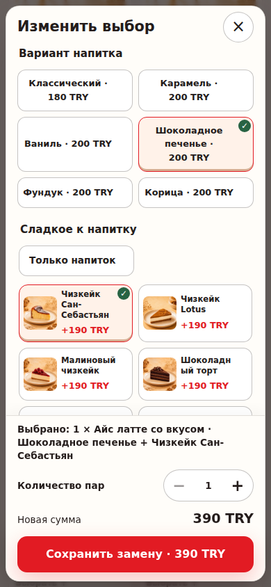
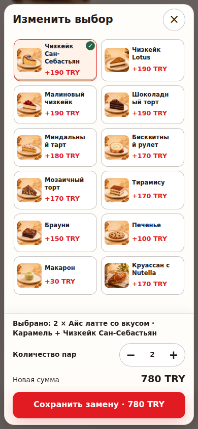

# Quick-builder option position, 20 October 2026

Switching classic and flavoured iced latte adds or removes a description above the option buttons. The old runtime moved the tapped caramel control by **57.28125 px**. The replacement preserves the control position, dialog scroll and keyboard focus across drink, dessert and quantity edits.

The attached reports cover **27 successful product journeys**: Chromium and Firefox (9 each over loopback HTTP), WebKit (9 over local HTTPS), TR/EN/RU, and 390×844, 360×720 and 1280×900 profiles. Both Chromium and Firefox also passed a Russian mobile HTTPS confirmation, giving two additional cases. Maximum measured movement after the fix was **0.367 px**. Closing cancels the edit; explicit Save preserves the canonical flavour, dessert and quantity after reload.

The earlier HTTP WebKit startup failed before the app loaded: its CSP upgraded subresources to HTTPS against an HTTP-only test server. Those startup failures remain in the HTTP report. The final regression serves production bytes over HTTPS with the original CSP. Local Firefox used `MOZ_DISABLE_CONTENT_SANDBOX=1` because this container restricts namespaces; CI does not set it.

`npm run check`, `npm run verify:security` (354 contracts plus secret scan), `npm run verify:performance` and `npm run verify:integrity` (459 files) passed on identical production bytes. The test-source HTTPS change was separately exercised. Browser profiles are desktop engines, not physical Android/iOS certification. The local source tree was `3f57fc89e438eeecfa5d7e6bc210aea55ae5c10a`; report asset hashes bind the tested production files regardless of commit metadata used for upload. This is assistant verification, without independent human approval.

Reproduce after building: `node scripts/test-quick-builder-scroll-browser.mjs`. The new CI step runs this in its existing Chromium/Firefox/WebKit matrix and retains artifacts. The old-code negative control uses base `b6ca90b98b679d80c5091519c01e6b77bb8177e1` and fails on the expected 57.28125 px movement.

The captures below show two exercised states in the fixed Chromium HTTPS journey; they are not an image-diff pair. Geometry measurements are in the JSON reports.

