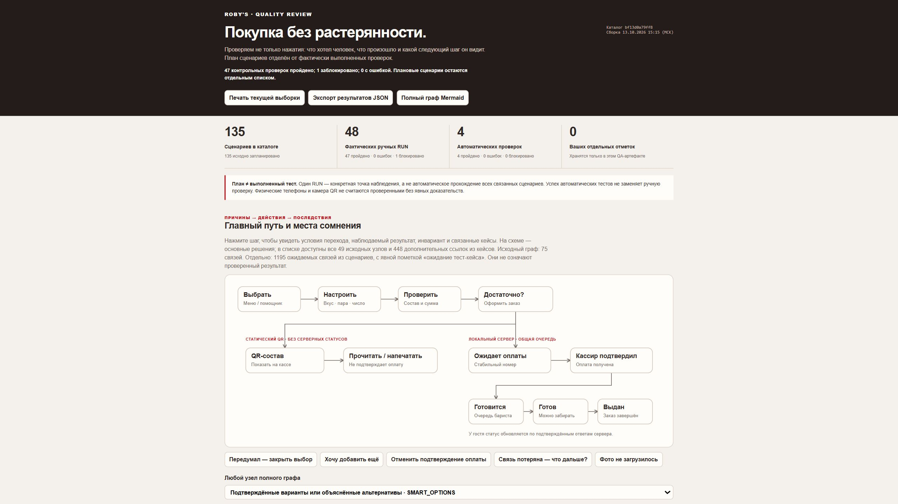

# Проверка регрессионного набора · 13 октября 2026

Сохранены 135 подробных сценариев: 65 покупательских, 40 для общей очереди и сотрудников, 30 для переходов, языков, доступности, сети и масштаба. Все исходные сценарии имеют статус `planned`; результат отдельной контрольной точки не повышает статус целого сценария.

В журнале 48 записей: 47 ручных контрольных точек пройдены, одна проверка ширины заблокирована инструментом. Отдельно записаны четыре группы автоматических проверок. Полные предусловия, действия и ожидаемые результаты доступны в `regression.md` и автономном `report.html`.

Граф содержит 49 основных узлов и 75 связей пути пользователя. Дополнительные связи сценариев помечены как ожидания теста, а не доказательства исполнения. Семантические группы помогают найти кейсы этапа и не добавляют переходы приложения.

## Что проверено в самом отчёте

- Поиск `GUEST-006` оставляет один из 135 сценариев. Раскрытие показывает предусловия, шаги, точные суммы, варианты прогона и причины/эффекты.
- Выбор `SMART_OPTIONS` показывает GUEST-031/032/033/034, связанные с бюджетом, полезными альтернативами и передачей выбора в конструктор.
- Нажатие «Настроить» на SVG-схеме открывает `CUSTOMIZE` с условиями перехода и связанными сценариями.
- План, ручной журнал и автоматические результаты имеют отдельные счётчики. Журналы свёрнуты; граф и каталог находятся выше них.
- Генератор проверяет уникальность ID, ссылки графа, структуру данных и отсутствие явных секретов. Повторная сборка из репозитория прошла.
- Проверки целостности сайта и поиск секретов прошли. Функциональный код приложения в рамках создания этого набора не изменён.

## Границы доказательств

Ручные проверки выполнялись на отдельной QA-базе на порту 8790. Подтверждение оплаты использовало синтетические тестовые заказы и не списывало деньги. Состав и сумма были проверены от корзины до выданного заказа; источник кода зафиксирован в `environment.json`.

В первой браузерной сессии изменение viewport не меняло наблюдаемую ширину 2560 px, а снимки не захватывались. Мобильная адаптивность и физическая камера QR этим прогоном не подтверждены. После восстановления браузерного инструмента удалось сохранить снимок самого QA-отчёта; это не превращает мобильные кейсы сайта в пройденные.

Принудительные сетевые ошибки, гонки и остальные варианты каждого сценария остаются планом там, где нет отдельного фактического RUN. Сохранённые DOM-наблюдения подтверждают финальные состояния нескольких экранов; они не являются покадровым протоколом всех 47 контрольных точек.

